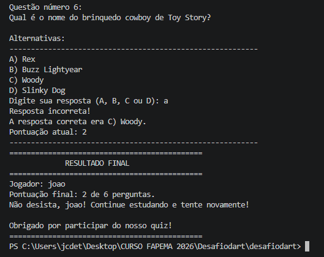

# Quiz de Filmes, Séries e Cultura Pop

## Sobre o projeto

O **Quiz de Filmes, Séries e Cultura Pop** é um jogo de perguntas e respostas desenvolvido em **Dart** para ser executado no terminal do computador.

O jogador informa seu nome e responde a seis perguntas relacionadas a filmes e séries, escolhendo uma das alternativas disponíveis (A, B, C ou D). Ao final de cada pergunta, o programa informa se a resposta está correta. Quando há um erro, apresenta a alternativa correta. No encerramento, mostra a pontuação e uma mensagem de acordo com o desempenho do jogador.

## Autor

- **Nome:** João Carlos dos Santos Almeida
- **Modalidade:** Individual
- **Trilha:** [Desenvolvimento Mobile]

## Tecnologias utilizadas

- Dart
- Dart SDK
- Visual Studio Code (ambiente de desenvolvimento)

## Estrutura do projeto

```text
desafiodart/
├── bin/
├── lib/
├── test/
├── imagens/
│   └── resultado-quiz.png
├── README.md
└── pubspec.yaml
```

- `bin/desafiodart.dart`: contém o código principal e controla a execução do quiz.
- `lib/desafiodart.dart`: contém a classe `Questao` e a lista de perguntas, alternativas e respostas corretas.
- `test/desafiodart_test.dart`: contém os testes automatizados do projeto, caso estejam implementados.

## Demonstração do Quiz

Abaixo está uma captura de tela mostrando
o funcionamento do jogo no terminal.



## Como executar

1. Instale o Dart SDK no computador.
2. Abra o terminal na pasta raiz do projeto (`desafiodart`).
3. Execute o comando abaixo para obter as dependências:

   ```bash
   dart pub get
   ```

4. Inicie o quiz com:

   ```bash
   dart run
   ```

## Exemplo de pergunta

**Em qual série aparece o personagem Eleven (Onze)?**

- A) Stranger Things
- B) The Witcher
- C) The Umbrella Academy
- D) The Mandalorian

**Resposta correta:** A) Stranger Things.

## Funcionalidades

- Solicita o nome do jogador antes de iniciar.
- Apresenta as perguntas e quatro alternativas.
- Aceita respostas em letras maiúsculas ou minúsculas.
- Solicita uma nova resposta quando a alternativa digitada é inválida ou está vazia.
- Informa quando o jogador acerta ou erra e, em caso de erro, mostra a resposta correta.
- Contabiliza os acertos e apresenta a pontuação final.
- Exibe uma mensagem final conforme o desempenho.

## Verificação e testes

Para formatar e analisar o código, execute na raiz do projeto:

```bash
dart format .
dart analyze
```

Para executar os testes automatizados, utilize:

```bash
dart test
```

Para conferir o funcionamento do jogo, execute também `dart run` e teste respostas corretas, incorretas, letras minúsculas e entradas inválidas ou vazias.

## Uso de inteligência artificial

A inteligência artificial foi utilizada como ferramenta de apoio durante o desenvolvimento. Ela ajudou a interpretar os requisitos do desafio, revisar a estrutura do código Dart, identificar problemas de sintaxe e lógica, e orientar a organização do projeto e deste README.

O tema, as perguntas e as alternativas do quiz foram definidos para o projeto e o código foi revisado e adaptado durante o desenvolvimento. A verificação do resultado é feita por meio da análise do projeto (`dart analyze`), dos testes automatizados (`dart test`, quando disponíveis) e da execução prática do quiz no terminal (`dart run`).
